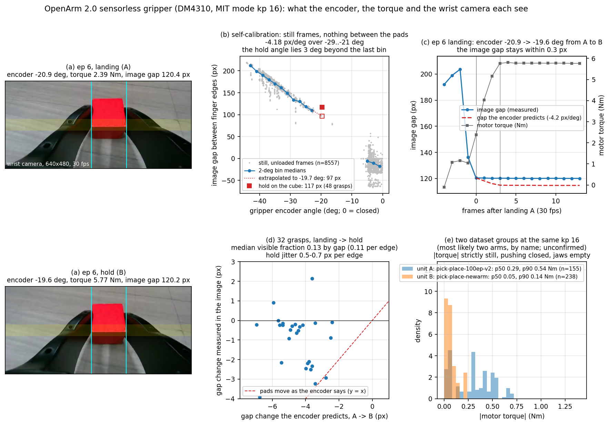

# The force floor of a sensorless gripper (OpenArm 2.0), measured from public teleop data

One person, no arm in the room, public LeRobot v3 datasets recorded on OpenArm 2.0 follower arms. The full note, with
every number, its confidence and what is not claimed, is [notes/floor_en.md](notes/floor_en.md).

Shortest version (details, confidence per number and caveats are in the note):

- The logged torque is kp × (command − position) on still frames, to three digits, in every dataset and every upload
  batch. Nothing in the stack reads it back as force; the hold on a cube is 5.0–5.3 Nm of position error.
- Two groups of datasets at the same gains differ 3–4× in gripper friction (closing freely 0.61–0.92 Nm vs 0.20 Nm;
  most likely two arms, unconfirmed), and the level steps 17 % between upload batches of one dataset. The official
  MuJoCo model has finger `frictionloss="0"`.
- After the pads land on a wooden cube the encoder advances +1.0° while torque rises +2.5 Nm; the wrist camera,
  self-calibrated against finger angle, sees the pads move 0.1 of that. About 90 % is wind-up between motor and pad
  (≈ 140 Nm/rad, computed). After contact the encoder is not a displacement sensor.
- Undecided and reported as such: spring versus friction on the opening side (not identifiable from torque–angle data);
  a fake strawberry's camera/encoder ratio (the pre-registered window was ill-conditioned).

Contents: `notes/` (the English note, the Japanese lab notes with every intermediate table, a ten-minute per-unit
protocol for anyone with an arm), `floor/` (analysis scripts; Python 3.10, numpy, pyarrow, ffmpeg; run with
`python3 -I` against downloaded data in a separate directory), `tools/openarm_floor_logger.py` (the protocol's logger;
dry run and mock only, never run on hardware).

Data: `gtgando/*` and `xhaka3456/*` on Hugging Face (links in the note). Simulator: `enactic/openarm_mujoco`;
the parameter request is `enactic/openarm#336`.

## License

MIT, see `LICENSE`; the datasets and the simulator named above keep their own licenses.
